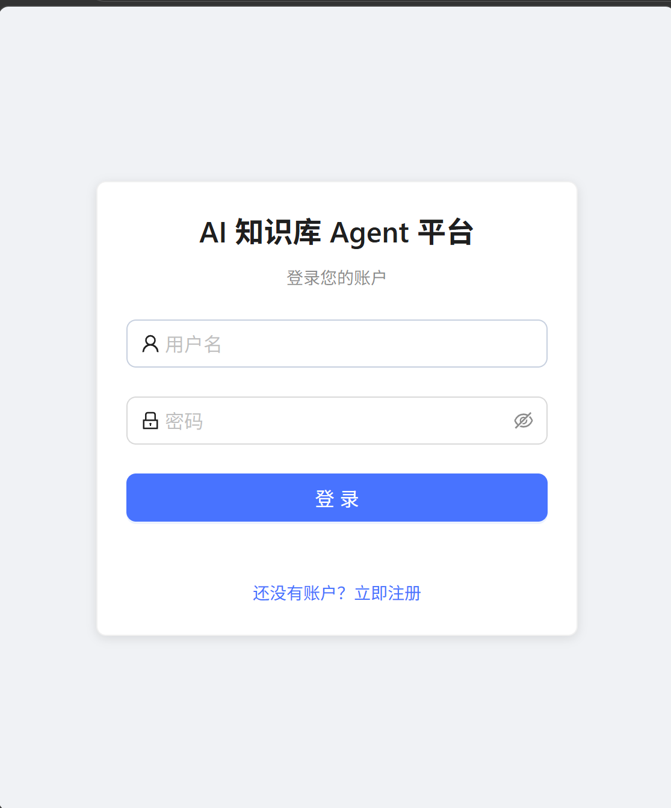
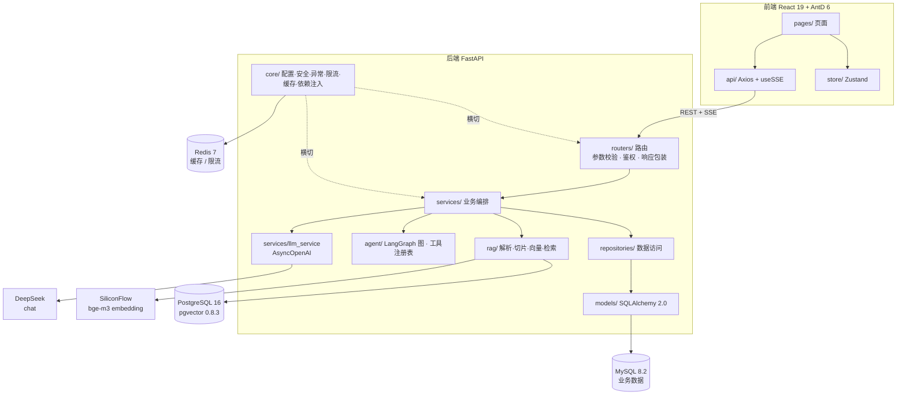

<div align="center">

# AI 知识库 Agent 平台

**RAG 知识库问答 + 工具调用 Agent 的全栈工程实践**

从文档上传、切片、向量化、语义检索，到流式问答与 Agent 工具编排，
一条完整的「企业级 AI 应用」主链路，配可解释的分层架构与可验证的工程过程。

[](https://www.python.org/)
[](https://fastapi.tiangolo.com/)
[](https://www.sqlalchemy.org/)
[](https://react.dev/)
[](https://www.typescriptlang.org/)
[](https://github.com/pgvector/pgvector)
[](https://redis.io/)
[](#许可证)

[快速开始](#快速开始) · [系统架构](#系统架构) · [API 概览](#api-概览) · [项目状态](#项目状态与已知限制) · [文档索引](#文档索引)

</div>

---

## 目录

- [项目简介](#项目简介)
- [核心特性](#核心特性)
- [界面预览](#界面预览)
- [系统架构](#系统架构)
- [技术栈](#技术栈)
- [目录结构](#目录结构)
- [快速开始](#快速开始)
- [配置说明](#配置说明)
- [API 概览](#api-概览)
- [SSE 流式事件协议](#sse-流式事件协议)
- [测试](#测试)
- [项目状态与已知限制](#项目状态与已知限制)
- [Roadmap](#roadmap)
- [设计取舍 FAQ](#设计取舍-faq)
- [文档索引](#文档索引)
- [贡献](#贡献)
- [许可证](#许可证)

---

## 项目简介

这是一个**面向企业知识管理的 AI 问答系统**：把散落在 PDF / Word / Markdown / TXT 里的内部资料，变成可以语义检索、可以对话问答、可以被 Agent 调用工具的知识资产。

和"调一次大模型 API"的 Demo 不同，本项目刻意把企业应用真正需要面对的问题拆开实现：

| 企业应用的真问题 | 本项目的设计 |
|---|---|
| 文档大小超过模型上下文 | 解析 → 递归切片（`chunk_size=500` / `overlap=50`）→ 只把命中的切片送进 prompt |
| 业务数据与向量数据生命周期不同 | **双库设计**：MySQL 存业务，PostgreSQL + pgvector 存切片与向量 |
| 模型不知道内部资料 | RAG：问题向量化 → 余弦相似度 top-k → 注入 system prompt |
| 一个问题可能需要多个动作 | Agent：LangGraph 编排 + 函数调用（function calling）+ 工具注册表 |
| 等待整段回答体验差 | SSE 逐 token 流式输出（`text/event-stream`） |
| 高并发下数据库会被打满 | 连接池 + Redis 缓存 + 三级限流（用户/IP/全局） |
| 谁都能访问别人知识库 | JWT 鉴权 + 每条资源的 `verify_owner` 越权校验 + 管理员角色 |

> **这个仓库的定位**：一个**架构分层已达到企业级、工程化仍有缺口**的完整全栈项目。
> 它现在的状态、缺失的能力与修复路线，全部在 [docs/ENTERPRISE_GAP_REVIEW.md](docs/ENTERPRISE_GAP_REVIEW.md) 里逐条列出（35 项，带文件行号与验收标准）——**不掩饰、不吹指标**。

---

## 核心特性

| 模块 | 能力 | 状态 |
|---|---|:---:|
| 认证 | 注册、登录、Access + Refresh Token、自动续期、管理员角色 | ✅ |
| 知识库 | 创建 / 列表（含文档数）/ 详情 / 更新 / 删除，账户级隔离 | ✅ |
| 文档 | 上传（pdf/docx/md/txt/html）、文件名净化、流式落盘、递归切片、状态机（pending→processing→completed/failed）、切片预览 | 🟡 |
| 向量化 | OpenAI 兼容 Embedding API（默认 `BAAI/bge-m3`，1024 维）、pgvector `VECTOR(1024)` 列、维度三处强校验、历史切片补向量脚本 | ✅ |
| 检索 | 余弦相似度 top-k（**HNSW 索引** + `ef_search` 可调）、相似度阈值过滤、按文档 ID 范围下推（检索范围严格限定在选中知识库） | ✅ |
| 问答 | 多会话管理、历史上下文（当前问题只注入一次、按 token 预算裁剪）、RAG 增强、SSE 逐 token 流式、**Markdown 渲染 + 引用卡片 + 停止/重试**、失败必发 `event: error` | ✅ |
| Agent | LangGraph 思考-行动-观察循环 + 手写降级循环、3 个内建工具（联网搜索 / 计算器 / 知识库检索）、工具名去重、只暴露可执行工具、超限强制总结、**真流式**（工具与回答同一条流）、会话连续 | ✅ |
| 管理端 | 用户列表与启用禁用、工具启用禁用 | 🟡 |
| 基础设施 | 连接池、Redis 缓存、双窗口限流、统一响应体、4 类全局异常处理器 | ✅ |
| 可观测 | 结构化日志（人读/JSON 双格式）、`X-Request-ID` 贯穿、`/health` 真实探活、失败与重试计数、token 用量与首 token 延迟 | ✅ |

图例：✅ 可用 · 🟡 可用但有已知缺陷（见 [项目状态](#项目状态与已知限制)）· ⚪ 未实现

**尚未实现**：Docker 一键部署、CI、数据库迁移、RAG 评测指标、回答引用与反馈、Markdown 渲染、停止生成。这些都在 [Roadmap](#roadmap) 里。

---

## 界面预览

<div align="center">

</div>

> 更多界面证据（聊天、Agent 工具卡片、知识库管理等）见 [`docs/evidence/w1-smoke/`](docs/evidence/w1-smoke/)；这些是 2026-10-23 冒烟测试的原始截图，未做美化处理。

---

## 系统架构

### 分层



**依赖方向单一**：`routers → services → repositories → models`，禁止反向依赖；`schemas` 只被 router / service 引用；`core` 只提供横切能力，不含业务。

### 运行时拓扑

| 组件 | 位置 | 端口 | 说明 |
|---|---|---|---|
| 前端 | 本机 / Vite dev server | 3000（或 5173，需配 CORS） | `npm run dev` |
| 后端 | 本机 / uvicorn | 8000 | 从 `backend/` 目录启动 |
| MySQL | 本机服务 | 3306 | 业务库 `ai_kb_platform` |
| PostgreSQL | Docker | 5432 | 向量库 `ai_kb_vector`，需 `vector` 扩展 |
| Redis | Docker | 6379 | 缓存与限流（不可用时自动降级） |
| LLM | 公网 | 443 | 任意 OpenAI 兼容 API，默认 DeepSeek |
| Embedding | 公网 | 443 | 任意 OpenAI 兼容 API，默认 SiliconFlow bge-m3 |

### 双库设计（为什么不用一个库）

```
MySQL                          PostgreSQL + pgvector
├── users                      └── document_chunks
├── knowledge_bases                ├── id
├── documents                      ├── document_id   ← 跨库引用，无外键
├── chat_sessions                  ├── chunk_index
├── chat_messages                  ├── content
└── agent_tools                    ├── embedding vector(1024)
                                   └── extra_meta jsonb
```

- **MySQL** 承担用户、权限、会话这类强关系、需要事务的业务数据，生态与运维最成熟。
- **PostgreSQL** 承担切片与向量，因为 `pgvector` 提供原生 `vector` 类型、距离算子（`<=>` 余弦）和 ANN 索引（HNSW/IVFFlat），MySQL 没有等价能力。
- **代价**：跨库无外键约束，一致性必须由应用层保证（删除时先清 PG 再删 MySQL）。这个代价被明确记录为已知问题 [P1-3](docs/ENTERPRISE_GAP_REVIEW.md#3-p1-完善清单14-条)，并有孤儿清扫计划。

### 一次 RAG 问答的完整链路

```
POST /chat/sessions/{id}/messages  (或 GET .../messages/stream)
   │
   ├─ 1. 校验会话归属（verify_owner）
   ├─ 2. 校验知识库归属 → 取该库下所有 document_id
   ├─ 3. EmbeddingService.embed(question)         → 1024 维向量
   ├─ 4. DocumentChunkRepository.similarity_search → 余弦距离 top-k
   ├─ 5. Retriever._format_context                → 拼成带相关度的上下文文本
   ├─ 6. 注入 system prompt（"基于以下文档回答…"）
   ├─ 7. 保存用户消息 → 读取历史 → 组装 messages
   ├─ 8. LLMService.chat_stream                   → 逐 token 推送 SSE
   └─ 9. 落库完整回复 → 推送 done 事件
```

> 细节：相似度阈值（`VECTOR_SIMILARITY_THRESHOLD=0.7`）只在 `Retriever.retrieve_with_details()` 里生效，即 Agent 的知识库检索工具；普通聊天走 `retrieve()`，只做 top-k 不做阈值过滤。**同一个系统里两条检索路径行为不一致**，属于待收敛的实现差异。

---

## 技术栈

**后端**

| 类别 | 技术 | 版本 |
|---|---|---|
| 语言 | Python | 3.13 |
| Web 框架 | FastAPI + uvicorn | 0.136 / 0.49 |
| ORM | SQLAlchemy 2.0（async） | 2.0.50 |
| 业务库驱动 | aiomysql / pymysql | 0.3.2 / 1.1.1 |
| 向量库驱动 | asyncpg + pgvector | 0.31.0 / 0.4.2 |
| 缓存 / 限流 | redis-py | 8.0.0 |
| LLM 客户端 | openai（OpenAI 兼容） | 2.41.1 |
| Agent 编排 | LangGraph | 1.2.4 |
| 文本切片 | langchain-text-splitters | 1.1.2 |
| 认证 | python-jose + passlib(bcrypt) | 3.5.0 / 1.7.4 |
| 文档解析 | PyPDF2 + python-docx | 3.0.1 / 1.2.0 |
| 配置 | pydantic-settings | 2.14.1 |

**前端**

| 类别 | 技术 | 版本 |
|---|---|---|
| 框架 / 语言 | React + TypeScript | 19.2 / 6.0 |
| 构建 | Vite | 8.1 |
| UI | Ant Design + icons | 6.4 / 6.2 |
| 路由 / 状态 | React Router / Zustand | 7.18 / 5.0 |
| HTTP | Axios（含 401 自动刷新） | 1.18 |
| Lint | Oxlint | 1.69 |

> ⚠️ `backend/requirements.txt` 目前**滞后于实际环境**（仍写 fastapi 0.115 / openai 1.50 / langgraph 0.2）。重新锁定依赖是 [P0-9](docs/ENTERPRISE_GAP_REVIEW.md#p0-9-环境不可复现依赖与切片路径)。上表是**实测版本**。

---

## 目录结构

```
AI Knowledge Base Agent Platform/
├── backend/
│   ├── app/
│   │   ├── main.py                 # 应用入口：CORS、限流中间件、异常处理、路由注册、健康检查
│   │   ├── core/                   # 横切：配置、安全(JWT/密码)、异常、限流、缓存、Redis、依赖注入
│   │   ├── database/               # 双库引擎、会话工厂、pgvector 类型注册
│   │   ├── models/                 # 用户、知识库、文档/切片、会话/消息、Agent 工具
│   │   ├── schemas/                # Pydantic 请求/响应模型 + 统一响应体
│   │   ├── repositories/           # 数据访问层（含向量相似度检索）
│   │   ├── services/               # 业务编排（auth / user / kb / document / chat / agent / llm）
│   │   ├── routers/v1/             # HTTP 入口（auth/user/chat/knowledge_base/document/agent）
│   │   ├── rag/                    # 解析器、切片器、Embedding、VectorStore、Retriever
│   │   └── agent/                  # LangGraph 状态机与图、工具定义与执行
│   ├── alembic/                    # 迁移框架（versions 目前为空，见 P1-2）
│   ├── scripts/                    # init_db / seed_data / make_admin
│   ├── tests/                      # 单元测试（5 个文件；pytest 尚未装入 venv）
│   ├── requirements.txt
│   └── .env.example
├── frontend/
│   ├── src/
│   │   ├── api/                    # Axios 封装（client 含 401 刷新）
│   │   ├── components/             # Layout、ProtectedRoute、AdminRoute
│   │   ├── hooks/useSSE.ts         # fetch + ReadableStream 解析 SSE
│   │   ├── pages/                  # 登录/注册/仪表盘/聊天/Agent/知识库/文档/个人中心/管理端
│   │   └── store/                  # Zustand：auth、chat、app
│   ├── vite.config.ts
│   └── package.json
├── docs/
│   ├── ARCHITECTURE.md             # 架构设计文档（分层、链路、取舍）
│   ├── ENTERPRISE_GAP_REVIEW.md    # 企业级差距复核（35 项，含验收标准）★
│   ├── GAP_ANALYSIS.md             # 首轮审计报告（40 项，历史存档）
│   ├── INTERVIEW.md                # 面试题库
│   ├── CURRICULUM.md               # 学习课程
│   ├── TRACKER.md                  # 进度与证据台账
│   ├── evidence/                   # 冒烟测试原始证据（截图 + 日志）
│   └── screenshots/                # 界面预览
└── README.md
```

---

## 快速开始

### 前置要求

| 依赖 | 版本 | 说明 |
|---|---|---|
| Python | 3.12 / 3.13 | 需支持 `async` + `typing` 新语法 |
| Node.js | 20+ | 前端构建 |
| MySQL | 8.0+ | 业务数据 |
| PostgreSQL | 16 + pgvector | 向量数据（推荐用 Docker 镜像 `pgvector/pgvector:pg16`） |
| Redis | 7（可选） | 缓存与限流；不可用时自动降级 |
| LLM API Key | — | 任意 OpenAI 兼容服务（DeepSeek / OpenAI / 兼容网关） |
| Embedding API Key | — | 需与 `EMBEDDING_DIMENSION` 匹配（bge-m3 为 1024） |

### 1. 准备数据库

```sql
-- MySQL
CREATE DATABASE ai_kb_platform CHARACTER SET utf8mb4 COLLATE utf8mb4_unicode_ci;
```

```powershell
# PostgreSQL：推荐用带 pgvector 的镜像
docker run -d --name kb-postgres -p 5432:5432 `
  -e POSTGRES_PASSWORD=your_password `
  -e POSTGRES_DB=ai_kb_vector `
  pgvector/pgvector:pg16

# Redis（可选）
docker run -d --name kb-redis -p 6379:6379 redis:7-alpine
```

### 2. 启动后端

```powershell
cd backend

# 创建虚拟环境（项目约定用仓库根的 .venv；已存在则跳过本行）
python -m venv ..\.venv
..\.venv\Scripts\python.exe -m pip install -r requirements.txt
# 注意：requirements.txt 版本滞后（见下方技术栈告警），必要时按 P0-9 重新锁定

# 配置环境变量
Copy-Item .env.example .env
# 编辑 .env：至少填入 LLM_API_KEY / EMBEDDING_API_KEY / 数据库口令，
# 并把 EMBEDDING_DIMENSION 设为与模型和库列一致的 1024

# 建表：双库迁移（MySQL 业务表 + PG 向量表/索引）
..\.venv\Scripts\python.exe -m alembic upgrade head                 # MySQL
..\.venv\Scripts\python.exe -m alembic -n postgres upgrade head     # PostgreSQL

# 种子数据（内建工具注册）
..\.venv\Scripts\python.exe scripts\seed_data.py

# 启动
..\.venv\Scripts\python.exe -m uvicorn app.main:app --reload --port 8000
```

> **必须从 `backend/` 目录启动**：`config.py` 的 `env_file=".env"` 是相对当前工作目录解析的；从仓库根启动会读不到配置，静默使用默认值。这属于[可复现性缺口](docs/ENTERPRISE_GAP_REVIEW.md#12-可复现性)，修复计划见 Roadmap。

后端就绪检查：

```powershell
Invoke-RestMethod http://localhost:8000/health   # status / version
# Swagger UI: http://localhost:8000/docs
```

### 3. 启动前端

```powershell
cd frontend
npm install

# 开发期默认用 3000 端口，与后端默认 CORS 一致
npm run dev -- --port 3000
```

打开 <http://localhost:3000>，注册账号后即可使用。

### 4. 提升为管理员（可选）

```powershell
cd backend
..\.venv\Scripts\python.exe scripts\make_admin.py <你的用户名>
```

### 5. 端到端验证清单

按顺序走一遍，任何一步不符合预期都能在 [差距复核报告](docs/ENTERPRISE_GAP_REVIEW.md) 里找到对应根因：

- [ ] `/health` 返回 healthy，`/docs` 能看到路由
- [ ] 注册 → 自动登录 → 进入仪表盘
- [ ] 新建知识库 → 列表出现
- [ ] 上传一个 txt → 文档状态变 `completed`，切片数 > 0
- [ ] 文档详情能看到切片内容
- [ ] 聊天页选择该知识库 → 提问命中文档内容 → 逐字流式输出
- [ ] Agent 页问「计算 1024*768」→ 返回 `786432`，出现计算器工具卡片

---

## Docker 一键启动（本地全栈）

```powershell
Copy-Item .env.example .env    # 首次：按需填口令与 LLM/Embedding key
docker compose up -d           # 5 个服务：nginx + backend + mysql + postgres(pgvector) + redis
docker compose ps              # 等四个服务 healthy
start http://localhost
```

数据库**不发布端口**（避免与宿主机已有 MySQL/PG/Redis 冲突），API 走 nginx 同源反代 `/api`，不需要 CORS。完整说明、常用命令、故障排查见 [docs/DOCKER_DEPLOY.md](docs/DOCKER_DEPLOY.md)。

> ⚠️ 这是**本地一键复现**，不是生产部署：没有域名/HTTPS/多副本/监控/回滚。

---

## 效果评测

`backend/data/eval/` 里有一套**可复现**的评测集（8 篇制度类语料 + 36 道题，含 2 道无答案题），
`scripts/evaluate_rag.py` 用它算检索质量：

```powershell
cd backend
..\.venv\Scripts\python.exe scripts\evaluate_rag.py --mode both --sweep
..\.venv\Scripts\python.exe scripts\evaluate_rag.py --chunk-sizes 300,500   # 切片参数网格
```

两种模式：

| 模式 | 含义 |
|---|---|
| `retrieve` | 纯向量检索（不套阈值），看检索本身好不好 |
| `pipeline` | 走生产链路（含相似度阈值），看用户实际拿到的上下文 |

当前基线（`chunk=500/50`, `top_k=5`）：

| 指标 | 纯检索 | 生产链路（阈值 0.55） |
|---|---|---|
| recall@1 | 94.1% | 85.3% |
| recall@3 | 100% | 88.2% |
| MRR | 0.971 | 0.868 |
| 无答案误召回率 | — | 0% |
| 检索延迟 p50 / p95 | 41ms / 104ms | 44ms / 87ms |

> **这个评测集抓到的第一个问题**：原阈值 0.7 下，生产链路 recall@1 只有 **23.5%** ——
> 检索明明找对了，却被阈值丢掉，模型只好凭训练知识回答。`--sweep` 显示 0.55 是
> 「召回 85% 且不误召回」的拐点，于是默认值从 0.7 改成了 0.55。
>
> 语料只有 8 篇，绝对数值会随真实数据变化；**换 embedding 模型或积累真实语料后要重跑**。

---

## 数据库迁移

项目有**两个数据库**，各有一套版本目录，必须分别执行：

```powershell
cd backend
..\.venv\Scripts\python.exe -m alembic upgrade head                # MySQL（业务表）
..\.venv\Scripts\python.exe -m alembic -n postgres upgrade head    # PostgreSQL（切片/向量）
```

| 目标 | 配置段 | 版本目录 | metadata |
|---|---|---|---|
| MySQL | `[alembic]`（默认） | `alembic/versions_mysql/` | `MySQLBase` |
| PostgreSQL | `[postgres]` | `alembic/versions_pg/` | `PostgreSQLBase` |

常用命令：

```powershell
# 生成新迁移（先确认模型改完）
..\.venv\Scripts\python.exe -m alembic revision --autogenerate -m "描述"
..\.venv\Scripts\python.exe -m alembic -n postgres revision --autogenerate -m "描述"

# 查看当前版本 / 历史
..\.venv\Scripts\python.exe -m alembic current
..\.venv\Scripts\python.exe -m alembic history
```

**已有数据库接入迁移系统**（表是早先 `create_all` 建的）：要 `stamp` 而不是 `upgrade`，否则会重复建表。

```powershell
..\.venv\Scripts\python.exe -m alembic stamp head
..\.venv\Scripts\python.exe -m alembic -n postgres stamp head
```

> ⚠️ `alembic.ini` **必须保持纯 ASCII**：Alembic 用 `configparser` 读它，而它在 Windows 上按本地编码（zh-CN 为 GBK）解码，写 UTF-8 中文注释会直接 `UnicodeDecodeError`。

---

## 备份与恢复

数据丢了能回来，才算真的能交付。两个脚本 + 一份演练记录：

```powershell
cd backend
..\.venv\Scripts\python.exe scripts\backup_all.py            # 备份 MySQL + PG
..\.venv\Scripts\python.exe scripts\restore_all.py --drill   # 恢复到临时库并对数（安全）
..\.venv\Scripts\python.exe scripts\restore_all.py --yes     # 真恢复（会覆盖！）
```

最近一次演练：备份 1.39s / 恢复 1.97s，7 张表行数与源库完全一致。细节与恢复后冒烟清单见 [docs/BACKUP_RESTORE.md](docs/BACKUP_RESTORE.md)。

---

## 配置说明

全部配置来自 `backend/.env`（示例见 [`.env.example`](backend/.env.example)）。

| 变量 | 默认 | 说明 |
|---|---|---|
| `DEBUG` | `True` | 开发模式；**生产必须为 False**（会校验 JWT 密钥、关闭 SQL echo） |
| `CORS_ORIGINS` | `["http://localhost:3000", ...]` | JSON 数组；用 5173 端口时必须加进来 |
| `MYSQL_HOST/PORT/USER/PASSWORD/DATABASE` | localhost:3306 / root | 业务库 |
| `POSTGRES_HOST/PORT/USER/PASSWORD/DATABASE` | localhost:5432 / postgres / `ai_kb_vector` | 向量库，**需已 `CREATE EXTENSION vector`** |
| `REDIS_HOST/PORT/DB/PASSWORD` | localhost:6379 | 不可用时缓存/限流自动降级（`X-RateLimit-*` 仍在） |
| `JWT_SECRET_KEY` | ⚠️ 占位符 | **必须替换**；生产环境用默认值会拒绝启动（当前 DEBUG 下仅告警） |
| `JWT_ACCESS_TOKEN_EXPIRE_MINUTES` | `30` | Access Token 有效期 |
| `JWT_REFRESH_TOKEN_EXPIRE_DAYS` | `7` | Refresh Token 有效期 |
| `LLM_API_KEY / LLM_API_BASE / LLM_MODEL_NAME` | — / `api.deepseek.com/v1` / `deepseek-chat` | 任意 OpenAI 兼容服务 |
| `LLM_MAX_TOKENS / LLM_TEMPERATURE` | `4096` / `0.7` | 生成参数 |
| `EMBEDDING_API_KEY / EMBEDDING_API_BASE / EMBEDDING_MODEL_NAME` | — / — / `text-embedding-ada-002` | key/base 为空时回落到 LLM 的配置；本项目 `.env` 用 `BAAI/bge-m3` + SiliconFlow |
| `EMBEDDING_DIMENSION` | `1536`（代码默认） | **必须与模型输出维度、DB 列维度三者一致**；bge-m3 为 `1024`，当前库列也是 `1024`，务必显式设置 |
| `UPLOAD_DIR / MAX_UPLOAD_SIZE_MB / ALLOWED_EXTENSIONS` | `uploads` / `50` / pdf,docx,md,txt,html | 上传限制 |
| `VECTOR_CHUNK_SIZE / VECTOR_CHUNK_OVERLAP` | `500` / `50` | 切片参数（尚无实验数据支撑，见 P2-6） |
| `VECTOR_SIMILARITY_THRESHOLD` | `0.55` | 检索相似度阈值，**实测值**（0.7 会把 recall@1 压到 24%）；换 embedding 模型需重测 |
| `VECTOR_TOP_K` | `5` | 检索返回条数 |
| `HNSW_EF_SEARCH` | `40` | HNSW 候选集大小（越大召回越高、越慢） |
| `LOG_LEVEL / LOG_JSON / LOG_DIR` | `INFO` / `False` / `logs` | 日志级别、是否输出 JSON、日志目录 |
| `DB_ECHO_SQL` | `False` | 打开后会把 SQL 与参数打进日志（含用户消息，**仅排障时临时开**） |
| `LOGIN_MAX_FAILURES / LOGIN_LOCKOUT_MINUTES` | `5` / `15` | 登录失败锁定策略 |
| `RATE_LIMIT_ENABLED` | `True` | 关掉后不注册限流中间件（网关已限流 / 跑集成测试时用） |
| `LLM_ALLOWED_MODELS` | `[]`（仅默认模型） | 允许会话/请求指定的模型白名单，JSON 数组 |
| `LLM_FALLBACK_MODELS` | `[]` | 主模型超时/429/5xx 时依次尝试的备用模型 |
| `DOCS_ENABLED` | 跟随 `DEBUG` | 是否暴露 `/docs`、`/redoc`、`/openapi.json`；生产默认关 |
| `POSTGRES_DOCKER_CONTAINER` | `kb-postgres-published` | PG 跑在容器里时备份/恢复走 `docker exec` |
| `SEARCH_API_URL` | 空 | 留空时 `web_search` 返回模拟结果 |
| `RATE_LIMIT_USER/IP/GLOBAL_PER_MINUTE` | 30 / 60 / 1000 | 三级限流 |
| `DB_POOL_SIZE / DB_MAX_OVERFLOW / DB_POOL_PRE_PING` | 10 / 20 / True | 连接池 |

> ⚠️ 已知配置陷阱：`config.py` 默认值与 `.env.example` 都写着 `EMBEDDING_DIMENSION=1536`，而当前数据库列是 `vector(1024)`。用 1024 维模型（如 bge-m3）时必须显式设为 `1024`，否则写入报维度不匹配。这一"默认值 / 示例 / 库列"三处不一致已登记为 [P0-9](docs/ENTERPRISE_GAP_REVIEW.md#p0-9-环境不可复现依赖与切片路径)。

---

## API 概览

Base URL：`http://localhost:8000/api/v1` · 交互文档：`/docs` · 鉴权：`Authorization: Bearer <access_token>`

统一响应体：

```json
{ "code": 200, "message": "success", "data": { } }
```

分页响应：`data = { "items": [], "total": 0, "page": 1, "page_size": 20 }`

| 模块 | 方法与路径 | 说明 |
|---|---|---|
| 认证 | `POST /auth/register` | 注册并直接返回 token 对 |
| | `POST /auth/login` | 登录 |
| | `POST /auth/refresh` | 刷新（**轮换**：旧 refresh 用一次即失效） |
| | `POST /auth/logout` | 登出：吊销 refresh token |
| 聊天 | `GET /chat/models` | 可用模型列表（前端下拉框的数据源） |
| 统计 | `GET /stats/overview` | 当前用户的知识库/文档/失败文档/会话/消息数 |
| 用户 | `GET /users/me` · `PUT /users/me` | 当前用户信息 / 修改资料 |
| | `GET /users` | 用户列表（管理员） |
| | `PUT /users/{user_id}/status` | 启用/禁用（管理员） |
| 知识库 | `GET /knowledge-bases` | 列表（含文档数） |
| | `POST /knowledge-bases` | 创建 |
| | `GET /knowledge-bases/{id}` · `PUT` · `DELETE` | 详情 / 更新 / 删除 |
| 文档 | `GET /knowledge-bases/{kb_id}/documents` | 该库文档列表 |
| | `POST /knowledge-bases/{kb_id}/documents` | 上传（`multipart/form-data`，字段 `file`） |
| | `GET /documents/{doc_id}` | 详情 + 切片 |
| | `DELETE /documents/{doc_id}` | 删除（同时清 PG 切片与磁盘文件） |
| 会话 | `POST /chat/sessions` · `GET /chat/sessions` | 创建 / 列表（含消息数） |
| | `GET /chat/sessions/{id}` · `PUT` · `DELETE` | 详情（含历史消息）/ 改标题 / 删除 |
| 聊天 | `POST /chat/sessions/{id}/messages` | 非流式提问 |
| | `POST /chat/sessions/{id}/messages/stream` | **SSE 流式**（消息走 JSON body） |
| Agent | `POST /agent/chat` | 非流式 Agent 对话 |
| | `POST /agent/chat/stream` | **SSE 流式** Agent 对话（body 里带 `session_id`） |
| | `GET /agent/tools` | 工具列表 |
| | `POST /agent/tools` · `PUT /agent/tools/{id}/toggle` | 创建工具（仅存 schema）/ 启用禁用 |

> 两个流式接口都是 **POST + `text/event-stream`**：消息内容走 JSON body，不会进入访问日志或浏览器历史（P1-12 已修）。

---

## SSE 流式事件协议

### 通用约定

- 帧以**空行**分隔；一帧内允许多个 `data:` 行，客户端用 `\n` 拼接后整体 `JSON.parse`
- 行尾可为 `\n` 或 `\r\n`；`:` 开头是心跳注释，忽略
- 流在没有 `done` / `error` 的情况下结束 = **连接中断**，客户端必须报错（前端仅在还没吐出 token 时自动重试 1 次）
- 用户点「停止生成」会中断请求，已收到的内容保留并标注「已停止生成」，不算失败

### 普通聊天

```
data: {"token": "你", "done": false}
data: {"token": "好", "done": false}
data: {"token": "", "done": true}
```

可选前置事件：`event: rag` → `data: {"context_length": 512}`

### RAG 引用（P2-10）

选了知识库且检索命中时，在 token 之前先发一帧：

```text
event: rag
data: {"context_length":135,"citations":[{"document_id":7,"document_name":"差旅制度.md","chunk_index":0,"similarity":0.7655,"snippet":"# 差旅制度..."}]}
```

`citations` 就是前端引用卡片的数据源（文档名 + 第几段 + 相关度 + 160 字片段）。

### Agent

```
event: session      data: {"session_id": 1}
event: rag          data: {"context_length": 512}
event: tool_call    data: {"name": "calculator", "arguments": "{\"expression\":\"1024*768\"}"}
event: tool_result  data: {"name": "calculator", "result": "1024*768 = 786432"}
event: token        data: {"token": "1024×768 等于 786432"}
event: done         data: {"iterations": 2, "tool_calls_count": 1}
event: error        data: {"message": "..."}
```

前端用 `fetch` + `ReadableStream` 解析（`frontend/src/hooks/useSSE.ts`），而不是 `EventSource`——后者无法携带 `Authorization` 请求头。

---

## 错误码与 API 契约

所有接口返回同一个信封：`{code, message, data}`，前端以 `code` 为准；每个响应都带 `X-Request-ID`。

完整对照表（code → HTTP → 含义 → 触发场景 → 客户端动作，含 SSE 错误约定）见 [docs/API_ERRORS.md](docs/API_ERRORS.md)。

```powershell
# 开发环境：/docs 可交互调试（Swagger UI），/redoc 是只读版
start http://127.0.0.1:8000/docs
# 生产（DEBUG=false）：/docs、/redoc、/openapi.json 全部 404；需要临时查看可设 DOCS_ENABLED=true
```

---

## 代码质量门禁

```powershell
cd backend
..\.venv\Scripts\python.exe -m ruff check .        # 静态检查：0 问题
..\.venv\Scripts\python.exe -m mypy app            # 类型检查：0 问题（71 文件）
..\.venv\Scripts\python.exe -m pytest --cov=app    # 测试 + 覆盖率门禁（65%）
```

规则集、白名单理由、这一轮抓到的真 bug 清单见 [docs/CODE_QUALITY.md](docs/CODE_QUALITY.md)。

---

## 测试

```powershell
cd backend
..\.venv\Scripts\python.exe -m pip install pytest pytest-asyncio
..\.venv\Scripts\python.exe -m pytest -v          # 当前 158 passed
```

当前测试覆盖：

| 文件 | 覆盖内容 |
|---|---|
| `test_p0_1_failure_visibility.py` | 失败可见性契约：维度校验、检索失败抛错、上传落 `failed`、SSE 必发 `event: error` |
| `test_b1_agent_and_context.py` | 上下文只注入一次（chat/agent）、降级循环追加消息、超限兜底、异常状态码映射、工具名去重 |
| `test_b2_security_and_consistency.py` | 检索范围越权、文件名穿越、超限中断、维度三处一致、删库清切片、会话列表去 N+1 |
| `test_p1_14_reliability.py` | 429/5xx 重试、4xx 不重试、重试用尽、embedding 分批与顺序、流式只重试建流 |
| `test_b3_context_streaming_tools.py` | token 预算裁剪（保留最新、至少一条）、真流式 token / 分片工具参数拼装、无 executor 工具不外露 |
| `test_b4_observability_and_security.py` | request_id 透传与复位、JSON 日志字段、探活 200/503 语义、SQL echo 不随 DEBUG、限流加权、登录锁定、refresh 轮换与吊销 |
| `test_b5_migration_hooks.py` | 内容去重 409、`file_hash` 落库、失败原因持久化/清空、检索前设 `hnsw.ef_search` |
| `test_api_contract.py` | 统一信封（401/404/422）、`X-Request-ID`、`/health` 的 200/503 语义、路由表完整性 |
| `test_integration_api.py` | 注册登录、知识库 CRUD 与越权、会话生命周期、登出吊销（**需真实库**，无库自动跳过） |
| `test_eval_harness.py` | 评测集完整性（题目引用的文档必须存在）、recall@k/MRR/误召回算法、阈值扫描单调性 |
| `test_p2_model_and_stats.py` | 模型白名单解析、备选链去重、5xx 切换备用模型、4xx 不切换、统计按用户隔离 |
| `test_p2_api_contract.py` | `/docs` 开关三态、OpenAPI 标签、每个接口的错误响应、404/422 仍是统一信封 |
| `test_p2_citations_and_sse.py` | 引用元数据（文件名映射、片段截断、缺失降级、只查一次库）、`rag` 事件带 citations |
| `test_agent_tools.py` | 计算器安全求值（白名单 AST、非法语法拒绝） |
| `test_agent_service.py` | Agent 服务装配、工具定义传递 |
| `test_auth_rate_limit.py` | 用户级限流超限时 `get_current_user` 抛 429 |
| `test_config.py` | 配置默认值（CORS 等） |
| `test_exceptions.py` | 业务异常字段保留 |

> 现状：后端 **158 个用例**（154 个不依赖数据库与网络 + 4 个集成用例），覆盖率 **67.5%**（门禁 65%）；
> 前端 **19 个单测**（`npm test`，覆盖 SSE 分帧解析与断流/重试判定）。
> 仍缺：`conftest.py`、`TestClient` 级别的接口测试、数据库 fixture、覆盖率门槛。测试体系重建是 [P2-7](docs/ENTERPRISE_GAP_REVIEW.md#4-p2-优化清单12-条)。

前端检查：

```powershell
cd frontend
npm run lint      # Oxlint
npm run build     # tsc -b && vite build
```

---

## 项目状态与已知限制

> 这一节刻意写得比"特性列表"更悲观，因为**能准确说出系统哪里不行，比说它什么都能做更接近企业级**。
> 完整 35 项（含文件行号、影响、修复方案、验收标准）见 [docs/ENTERPRISE_GAP_REVIEW.md](docs/ENTERPRISE_GAP_REVIEW.md)。

### 最近更新

| 日期 | 内容 | 证据 |
|---|---|---|
| 2026-11-09 | 完成 **P2-8 代码质量门禁**：`ruff` 88 条 → **0**，`mypy` 45 条 → **0**（7 个框架噪音模块按白名单冻结并写明理由）。类型检查顺带抓到 3 个真 bug：空知识库聊天 500、`POST /agent/chat` 必崩、`zip` 未校验长度。见 [docs/CODE_QUALITY.md](docs/CODE_QUALITY.md) | — |
| 2026-11-09 | 完成 **D-1 容器化**：后端/前端多阶段 Dockerfile（镜像 120MB / 21.4MB）、`docker-compose.yml` 五件套（healthcheck + `service_healthy` 依赖顺序、命名卷、数据库不发布端口）、**一条命令本地起全栈**并跑通冒烟（注册→上传→RAG 问答）。详见 [docs/DOCKER_DEPLOY.md](docs/DOCKER_DEPLOY.md) | — |
| 2026-11-08 | 关闭 **对话体验**（P2-10、P2-11）：回答按 **Markdown** 渲染、**引用卡片**（后端 `event: rag` 回传文档名/相关度/片段）、**停止生成**（保留已收到内容）、**重试**；SSE 解析改为**按空行分帧 + 多行 `data:` 拼接**，断流会明确报「连接中断」，未吐字前自动重试 1 次。前端新增 19 个单测（`npm test`） | — |
| 2026-11-08 | 关闭 **模型选择 / 真实统计 / API 契约 / 备份恢复**（P2-4、P2-9、P2-2、D-3）：会话与请求级模型真正生效并支持主备切换（`GET /chat/models` + 前端下拉）、Dashboard 改用 `/stats/overview` 真实数字、新增 [错误码表](docs/API_ERRORS.md) 与 31 个中文 summary 且`/docs` 生产默认关闭、[备份恢复脚本](docs/BACKUP_RESTORE.md) 并完成演练（7 张表行数一致） | — |
| 2026-10-28 | 补齐 **B5**：**评测集与指标**（36 题 / 8 篇语料，recall@k + MRR + 阈值扫描）、**测试体系**（conftest + 接口级 11 个 + 集成 4 个 + 覆盖率门禁 65%）。评测直接抓出「阈值 0.7 把 recall@1 从 94% 压到 24%」，已改为实测的 0.55 | [B5 修复记录](docs/ENTERPRISE_GAP_REVIEW.md#b5-批次修复记录2026-10-28) |
| 2026-10-28 | 关闭 **B5（P1 部分）**：双库 **Alembic 迁移**（基线 + HNSW 索引 + 两列新字段）、**HNSW 索引**（`m=16, ef_construction=64`，检索按 `hnsw.ef_search` 调召回）、失败原因**持久化**、sha256 **内容去重**。期间修掉「写入在响应后才提交，导致紧接着的读/去重读到旧快照」 | [B5 修复记录](docs/ENTERPRISE_GAP_REVIEW.md#b5-批次修复记录2026-10-28) |
| 2026-10-28 | 关闭 **B4 批次**（P1-9/10/12/13）：结构化日志 + `X-Request-ID` 贯穿全链路、`/health` 真实探活三项依赖、SSE 改 **POST**（消息不再进 URL）、refresh **轮换** + 登出吊销、双窗口限流 + 登录失败锁定。期间抓到并修掉「SQL 日志泄漏用户消息」 | [B4 修复记录](docs/ENTERPRISE_GAP_REVIEW.md#b4-批次修复记录2026-10-28) |
| 2026-10-28 | 关闭 **B3 批次**（P1-5/6/7/14）：上下文改按 token 预算裁剪、**Agent 真流式**（逐 token 推送，首 token 从「整段生成完」降到 ~500ms）、无 executor 的动态工具不再交给 LLM、上游调用加超时 + 指数退避 + embedding 分批 | [B3 修复记录](docs/ENTERPRISE_GAP_REVIEW.md#b3-批次修复记录2026-10-28) |
| 2026-10-28 | 关闭 **B2 批次**（P0-3/7/8/9、P1-3/4）：Agent 检索严格限定选中知识库、JWT 密钥轮换、上传流式落盘 + 文件名净化、依赖重锁 + 切片器修复、删库清 PG 切片、会话列表去 N+1。**P0 全部清零**；另补了补向量脚本与孤儿清扫脚本 | [B2 修复记录](docs/ENTERPRISE_GAP_REVIEW.md#b2-批次修复记录2026-10-28) |
| 2026-10-28 | 关闭 **B1 批次**（P0-2/4/5/6、P1-8）：问题不再重复注入、Agent 超限有兜底、Agent 对话可连续、错误码语义正确、降级不丢消息；另修掉 6 个此前无人发现的 bug（**工具名重复导致所有 Agent 请求 400**、非流式 Agent `NameError`、依赖层把 404 吞成 500 等） | [B1 修复记录](docs/ENTERPRISE_GAP_REVIEW.md#b1-批次修复记录2026-10-28) |
| 2026-10-28 | 关闭 **P0-1「失败静默」**：上传失败落 `failed` + 原因、检索失败抛 `RetrievalError(503)`、SSE 必发 `event: error`、`/health` 暴露失败计数；补 16 个回归用例 | [修复记录](docs/ENTERPRISE_GAP_REVIEW.md#p0-1-上传检索失败静默文档仍标-completed) |
| 2026-10-28 | 补装 `cryptography`：缺失会让 MySQL 8 `caching_sha2_password` 认证失败，后端所有认证请求 500 | [requirements.txt](backend/requirements.txt) |
| 2026-10-28 | 输出 [修复执行清单](docs/FIX_PLAN.md)：剩余 31 项按 8 个批次排序，标注文件行号、改法与验收 | [FIX_PLAN.md](docs/FIX_PLAN.md) |

### 会直接影响使用的限制

| 限制 | 现象 | 影响 |
|---|---|---|
| **上传仍同步处理** | 解析/切片/向量化都在请求内完成（已不阻塞事件循环、不爆内存，但没有任务队列） | 大文档上传耗时较长，接口会一直占着连接（B6 之后引入后台任务） |
| **动态工具只能展示** | 管理端"新增工具"只存 schema；没有 executor 的工具已不再交给 LLM | 想真正新增工具仍需在 `_TOOL_EXECUTORS` 登记实现（P1-7 的过滤方案已落地） |
| **仅 3000 端口可用** | CORS 默认只放行 3000 | 用 5173 会被浏览器拦截 |
| **登出后 access token 仍有效** | 只吊销 refresh；access 是无状态短票 | 最坏情况有 ≤30 分钟窗口（access 无法吊销是因为没做黑名单） |
| **token 仍在 localStorage** | 已修 SSE 走 POST，但 token 存储方式未变 | XSS 可窃取；需配合 refresh-on-boot 与 CSRF 策略 |
| **断线不能续传** | 断流会报错并可重试，但没有 `Last-Event-ID` 断点续传（重试是整轮重发） | 超长回答在弱网下要重新生成；续传需后端支持按事件 ID 回放 |
| **备份与业务库同机** | 备份文件在 `database-backups/`，没有异地副本、未加密 | 磁盘坏了备份一起没；生产需异地存储 + 加密 |
| **Vector codec 未注册** | `session.py` 在同步事件里调用 async 的 `register_vector` → 协程从未 await | 实测 ORM 向量读写可用（走 pgvector 自带类型处理，已端到端验证），但这是明显的错误代码（N-7） |

### 尚未具备的企业级能力

- ❌ Dockerfile / docker-compose / CI
- ❌ RAG 评测（无数据集、无 `recall@k`、参数无实验依据）
- ❌ 反馈闭环（赞/踩/纠错入库）
- ❌ 测试覆盖率与回归门槛
- ❌ 上传异步化、文件去重、文件名净化（存在路径穿越风险）
- ❌ Token 吊销 / refresh 轮换、软删除与审计日志

---

## Roadmap

| 阶段 | 目标 | 关键事项 |
|---|---|---|
| **B1 止血** ✅ | 系统不再"骗人" | ~~失败可见（P0-1）~~、~~去重复注入（P0-2）~~、~~Agent 兜底（P0-4）~~、~~前端答案不消失（P0-5）~~、~~状态码修正（P0-6）~~、~~降级不丢消息（P1-8）~~ — **已完成** |
| **B2 可信** ✅ | 数据与权限正确 | ~~KB 范围下推（P0-3）~~、~~密钥与上传安全（P0-7/8）~~、~~依赖锁定（P0-9）~~、~~删库一致性（P1-3）~~、~~会话 N+1（P1-4）~~ — **已完成** |
| **B3 性能与上下文** ✅ | 长会话不爆、Agent 真流式、工具能真执行 | ~~token 预算（P1-5）~~、~~真流式（P1-6）~~、~~工具可执行性（P1-7）~~、~~超时重试（P1-14）~~ — **已完成** |
| **B4 可观测** ✅ | 问题能被发现 | ~~结构化日志 + request_id（P1-9）~~、~~真实健康检查（P1-10）~~、~~SSE 安全（P1-12）~~、~~限流修正（P1-13）~~ — **已完成** |
| **B5 可评测** ✅ | 效果能被证明 | ~~HNSW（P1-1）~~、~~迁移（P1-2）~~、~~评测集 + recall@k（P2-6）~~、~~测试体系（P2-7）~~ — **已完成** |
| **B6 可交付** 🟨 | 别人能跑起来 | ~~备份恢复（D-3）~~、~~Docker Compose（D-1）~~、~~ruff/mypy 门禁（P2-8）~~ ✅ — 剩清理散落脚本（P2-1）、CI（D-2） |
| **B7 产品化** 🟨 | 用户愿意用 | ~~前端数据修正（P2-9）~~、~~API 契约（P2-2）~~、~~Markdown/引用/停止/重试（P2-10）~~、~~SSE 解析与断流（P2-11）~~ ✅ — 剩软删除与审计（P2-3） |
| **B8 收尾** 🟨 | 多模型、prompt 治理、压测与许可 | ~~模型切换与 fallback（P2-4）~~ ✅ — 剩 prompt 版本与注入防护（P2-5）、压测/反馈/License（P2-12） |

> 逐条的"改哪个文件哪一行、怎么验收"见 [docs/FIX_PLAN.md](docs/FIX_PLAN.md)。

---

## 设计取舍 FAQ

<details>
<summary><b>为什么是双数据库，而不是全部放 PostgreSQL？</b></summary>

MySQL 承担强关系业务数据（用户/权限/会话），团队更熟悉、运维更简单；PG 只负责 `vector` 类型与 ANN 索引这些 MySQL 不具备的能力。
代价是跨库无外键，一致性靠应用层补偿——这是被明确记录并计划修复的技术债（P1-3），不是被忽略的问题。
</details>

<details>
<summary><b>为什么用 LangGraph，而不是自己写 while 循环？</b></summary>

Agent 本质是状态机（LLM 节点 → 条件边 → 工具节点 → 回边），LangGraph 把它显式建模成图，可检查点、可中断、可可视化。
项目同时保留了手写循环作为降级路径——但这恰恰引入了新的 bug（降级时用 `dict.update` 替换而非追加消息），已登记 P1-8。
</details>

<details>
<summary><b>切片为什么是 500 字符 / 50 重叠？</b></summary>

坦白说：**目前没有数据依据**，是经验默认值。正确做法是建评测集，对 300/500/800 × 0/50/100 做网格实验，用 `recall@5` 选最优——这正是 Roadmap B4 要做的事。
</details>

<details>
<summary><b>SSE 为什么用 fetch 而不是 EventSource？</b></summary>

`EventSource` 不支持自定义请求头，无法携带 `Authorization: Bearer`。所以用 `fetch` + `ReadableStream` 手工解析 SSE 帧（`frontend/src/hooks/useSSE.ts`）。
代价是失去浏览器内建的重连与事件 ID 能力——已登记为 P2-11。
</details>

<details>
<summary><b>为什么消息内容走 GET query？</b></summary>

历史原因，简单直接。但它会把用户消息写进访问日志、受 URL 长度限制——已登记 P1-12，计划改 `POST + text/event-stream`。
</details>

<details>
<summary><b>Embedding 维度为什么必须是 1024？</b></summary>

`bge-m3` 输出 1024 维，而 `pgvector` 的 `vector(n)` 维度在**建表时就固定**，且 HNSW 索引要求维度匹配。
所以「模型维度 = `EMBEDDING_DIMENSION` = 数据库列维度」必须三处一致，换模型就得做迁移。这也是为什么配置错维度会直接写库失败的原因。
</details>

---

## 文档索引

| 文档 | 内容 |
|---|---|
| [docs/API_ERRORS.md](docs/API_ERRORS.md) | 错误码表与 SSE 错误约定 |
| [docs/BACKUP_RESTORE.md](docs/BACKUP_RESTORE.md) | 备份、恢复演练、恢复后冒烟清单 |
| [docs/DOCKER_DEPLOY.md](docs/DOCKER_DEPLOY.md) | Docker 一键启动、常用命令、踩坑记录、与生产的差距 |
| [docs/CODE_QUALITY.md](docs/CODE_QUALITY.md) | ruff/mypy 门禁、白名单理由、抓到的真 bug |

| 文档 | 内容 | 适合谁 |
|---|---|---|
| [**B1_STAGE_REPORT.md**](docs/B1_STAGE_REPORT.md) | ⭐ B1 批次复盘：5 项计划 + 7 个新发现、逐项 before/after、证据、12 条工程原则、岗位能力映射与 7 天带练 | 想弄清"为什么这么修"、准备面试的人 |
| [**ENTERPRISE_GAP_REVIEW.md**](docs/ENTERPRISE_GAP_REVIEW.md) | ⭐ 企业级差距复核：七维度对比 + 35 项问题（P0/P1/P2）+ 验收清单 | 想了解"还差什么"的人 |
| [**FIX_PLAN.md**](docs/FIX_PLAN.md) | ⭐ 修复执行清单：8 个批次 + 36 项待办，逐条标注"哪个文件哪一行、怎么改、怎么验收" | 准备动手改代码的人 |
| [ARCHITECTURE.md](docs/ARCHITECTURE.md) | 架构设计：分层职责、请求链路、双库、关键取舍 | 接手维护的工程师 |
| [GAP_ANALYSIS.md](docs/GAP_ANALYSIS.md) | 首轮审计报告（40 项，2026-10-23，历史存档） | 想看修复演进过程的人 |
| [TRACKER.md](docs/TRACKER.md) | 进度台账：每日记录、冒烟证据、遗留问题池 | 关注工程过程的人 |
| [INTERVIEW.md](docs/INTERVIEW.md) | 面向本项目的面试题库与答题要点 | 求职 / 复盘 |
| [CURRICULUM.md](docs/CURRICULUM.md) | 配套学习路径与知识点地图 | 想照着做一遍的人 |
| [frontend/README.md](frontend/README.md) | 前端专项：路由、状态、SSE、Axios 刷新链路 | 前端同学 |
| [docs/evidence/](docs/evidence/) | 冒烟测试原始证据（截图 + 日志 + 耗时） | 想验证真实性的人 |

---

## 贡献

这是一个以工程能力验证为目的的个人项目，目前不接受大规模外部 PR。

如果你发现问题，欢迎开 Issue 并提供：**复现步骤 + 期望行为 + 实际行为 + 相关日志**。
提交代码前请确保：

1. `cd frontend && npm run lint && npm run build` 通过；
2. 后端改动有对应的单元测试或可执行验收命令；
3. 涉及配置/接口变更时，同步更新本 README 与 `.env.example`。

---

## 许可证

本项目**尚未选定开源许可证**（见 [P2-12](docs/ENTERPRISE_GAP_REVIEW.md#4-p2-优化清单12-条)）。在补充 `LICENSE` 之前，默认保留所有权利，**请勿直接用于商业用途**。

## 免责声明

- 本项目为个人工程实践与学习项目，**未经生产环境验证**，请勿直接承载真实业务数据。
- `.env` 中的密钥、数据库口令、`uploads/` 与 `database-backups/` 均已被 `.gitignore` 排除；提交前请自行确认无泄漏。
- 大模型输出可能不准确。接入真实业务前，请务必完成 RAG 评测与 hallucination 兜底设计（见 Roadmap B4）。
- 使用第三方 API（DeepSeek / SiliconFlow 等）产生的费用由使用者自行承担。

---

<div align="center">

**如果这个项目对你有帮助，欢迎点一个 ⭐ Star**

</div>
