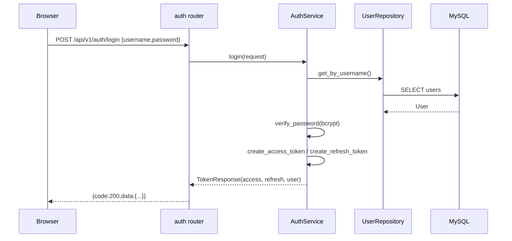
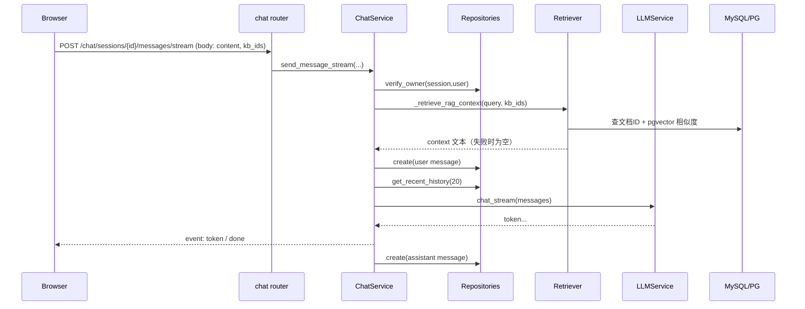
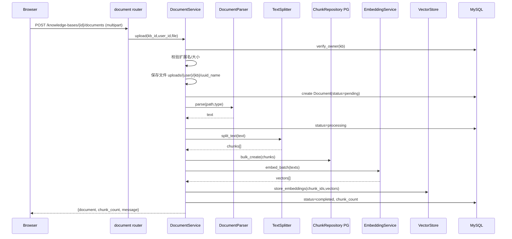
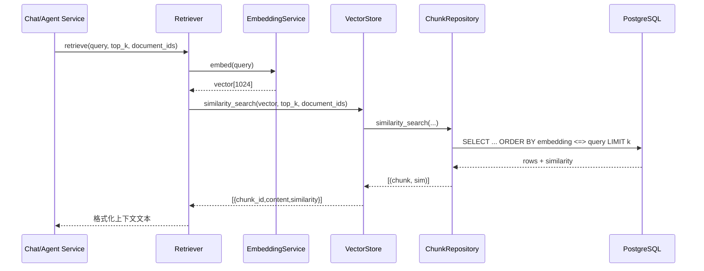
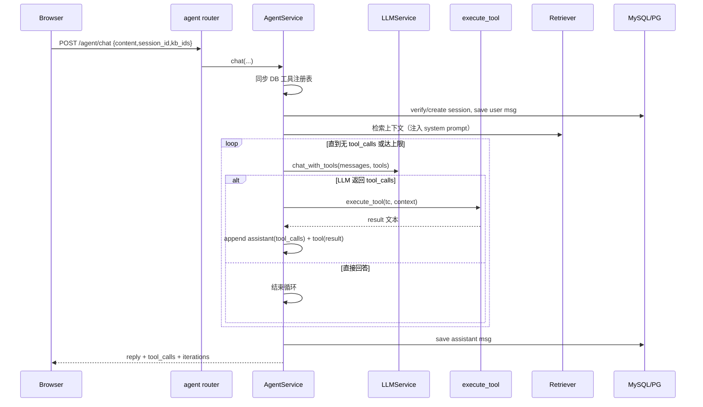
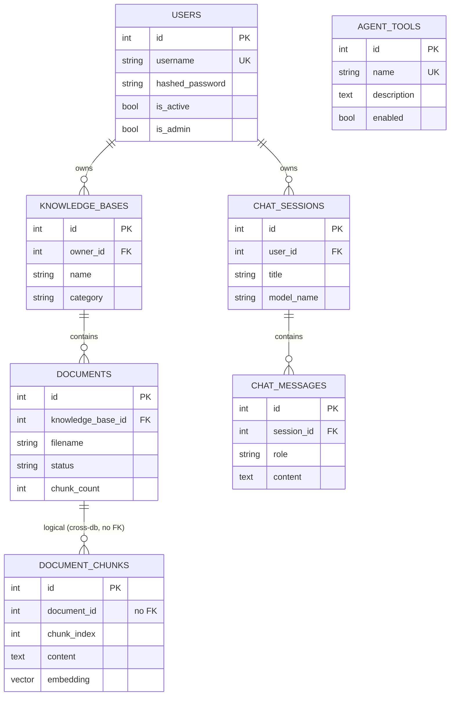
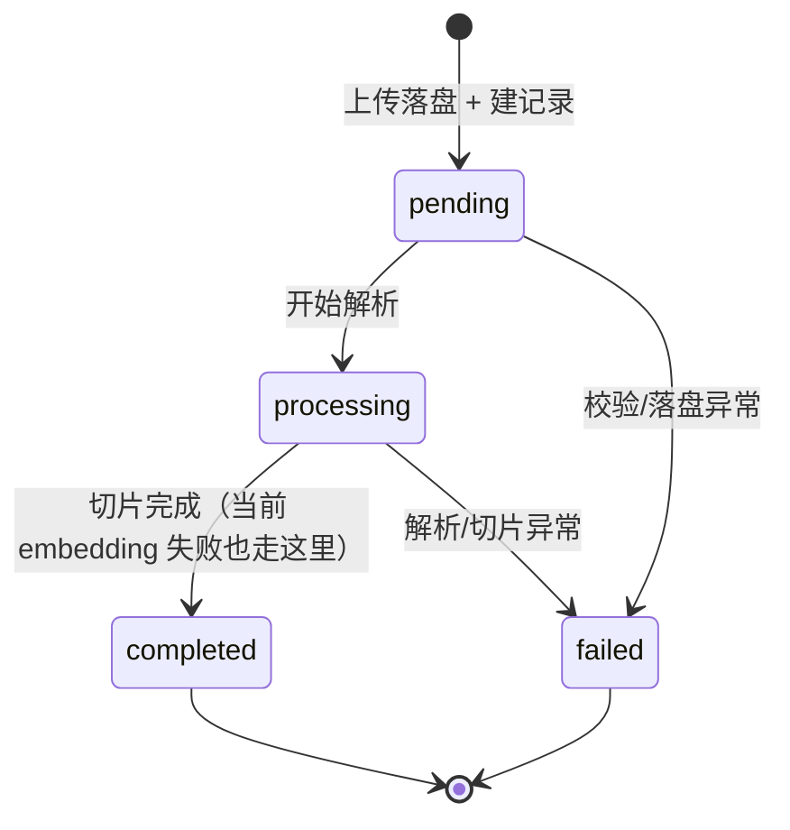
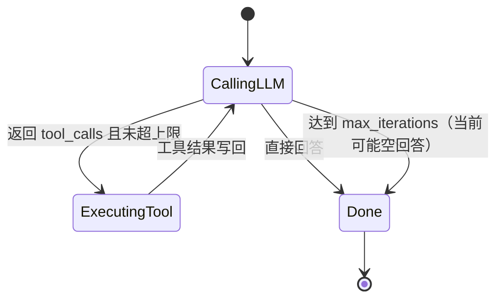
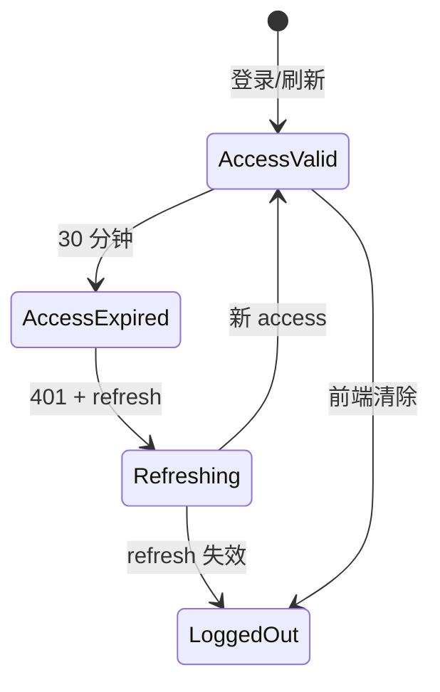

# 架构设计文档 — 企业级 AI 知识库 Agent 平台

> 配套文档：[差距审计](GAP_ANALYSIS.md) · [企业级复核](ENTERPRISE_GAP_REVIEW.md) · [根 README](../README.md) · [学习课程](CURRICULUM.md) · [面试题库](INTERVIEW.md)
> 本文描述**当前代码的真实架构**（含已知偏差），不是理想态。理想态的改造项统一链到差距审计。

---

## 1. 文档目的

回答四个问题：

1. 系统由哪些部分组成，部署在哪里，依赖谁？
2. 后端为什么分这几层，每层能做什么、不能做什么？
3. 一条请求从浏览器到数据库/大模型，中间经过了谁？
4. 关键设计为什么这么选，代价是什么，下一步怎么演进？

适用读者：项目作者（学习/面试）、接手维护的工程师、做代码 Review 的面试官。

---

## 2. 系统上下文

```
┌─────────────┐        HTTPS/SSE        ┌──────────────────────────────┐
│  浏览器      │ ◄─────────────────────► │  React SPA（Vite + AntD）     │
│  用户/管理员 │                         │  :3000 / :5173（开发）        │
└─────────────┘                         └──────────────┬───────────────┘
                                                       │ REST + SSE
                                                       ▼
                                        ┌──────────────────────────────┐
                                        │  FastAPI 应用（uvicorn）      │
                                        │  :8000 /api/v1                │
                                        └───┬──────────┬──────────┬────┘
                                            │          │          │
                          ┌─────────────────┘          │          └─────────────────┐
                          ▼                            ▼                            ▼
                 ┌────────────────┐          ┌──────────────────┐          ┌────────────────┐
                 │ MySQL 8.2      │          │ PostgreSQL 16    │          │ Redis 7        │
                 │ 业务数据        │          │ + pgvector 0.8.3 │          │ 缓存/限流       │
                 └────────────────┘          └──────────────────┘          └────────────────┘
                          │                            │
                          └──────────────┬─────────────┘
                                         ▼
                          ┌────────────────────────────────┐
                          │ 外部 AI 服务                    │
                          │ DeepSeek（chat, OpenAI 兼容）   │
                          │ SiliconFlow（bge-m3, 1024 维）  │
                          └────────────────────────────────┘
```

**边界说明**

- 浏览器只访问后端 `:8000`；没有 BFF/网关。
- 后端同时连两个数据库：MySQL 存业务，PG 存切片与向量；Redis 做缓存/限流。
- LLM 与 Embedding 都是 OpenAI 兼容 HTTP API，通过 `AsyncOpenAI` 调用。
- 当前无消息队列、无对象存储、无独立向量库、无反向代理（W7 加）。

---

## 3. 运行时拓扑（当前真实形态）

| 组件 | 位置 | 端口 | 说明 |
|---|---|---|---|
| 前端 | Windows 本机 | 3000 / 5173 | `npm run dev`；Vite 默认 5173，CORS 默认只放行 3000 |
| 后端 | Windows 本机 | 8000 | `uvicorn app.main:app`，从 `backend/` 启动 |
| MySQL | Windows 服务 `MySQL82` | 3306 | 业务库 `ai_kb_platform` |
| PostgreSQL | Docker 容器 `kb-postgres-published` | 5432 | 镜像 `ai-kb-postgres-pgvector:16-0.8.3`，库 `ai_kb_vector`，数据 bind `D:/PostgreSQL` |
| Redis | Docker 容器 `kb-redis` | 6379 | `redis:7-alpine` |
| LLM | 公网 | 443 | `https://api.deepseek.com/v1`，`deepseek-chat` |
| Embedding | 公网 | 443 | `https://api.siliconflow.cn/v1`，`BAAI/bge-m3`，1024 维 |

> 状态更新（2026-10-28 复核）：`pgvector` Python 客户端已安装（0.4.2），ORM 中 `embedding` 已是 `VECTOR(1024)`，DB 列也已完成 `vector(1536) → vector(1024)` 迁移，GAP-001/002 已关闭。存量切片仍未补向量。详见 [企业级复核](ENTERPRISE_GAP_REVIEW.md#02-与-2026-10-23-审计相比的变化本次实测确认)。

---

## 4. 后端分层与依赖规则

```
┌──────────────────────────────────────────────────────────────┐
│ routers/        HTTP 入口：解析参数、鉴权、调用 service、包装响应 │
├──────────────────────────────────────────────────────────────┤
│ services/       业务编排：事务边界、权限、RAG/Agent/LLM 调用      │
├──────────────────────────────────────────────────────────────┤
│ repositories/   数据访问：SQL/ORM、分页、过滤、向量查询           │
├──────────────────────────────────────────────────────────────┤
│ models/         ORM 表映射（MySQLBase / PostgreSQLBase）        │
└──────────────────────────────────────────────────────────────┘
      ▲ 依赖方向单向：routers → services → repositories → models
      │
core/        配置、异常、安全、限流、缓存、依赖注入（横切）
database/    引擎、会话工厂、pgvector 注册
schemas/     Pydantic 请求/响应契约
rag/         解析、切片、embedding、向量存储、检索
agent/       LangGraph 状态/图/工具
utils/       时间等小工具
```

**规则**

1. `routers` 不直接写 SQL，不直接 `commit`；只做 HTTP 语义。
2. `services` 不依赖 FastAPI 的 `Request`；通过构造参数拿 `AsyncSession`。
3. `repositories` 不抛业务异常（`AppException` 由 service 抛）。
4. `models` 不写业务逻辑；关系只做 ORM 映射。
5. `schemas` 不依赖 ORM；用 `from_attributes=True` 从 ORM 转换。
6. `core` 可被任意层依赖，但不能反向依赖 `services`。
7. `rag`/`agent` 是领域组件，可被 service 组合，不直接依赖 router。

**已知偏差**

- `agent/tools.py` 直接 `import settings` 和 `Retriever`，属于领域组件跨层引用（可接受但需注意循环依赖）。
- `services/agent_service.py` 内联了一段手写 Agent 循环，与 `agent/graph.py` 重复（见 GAP-013）。

---

## 5. 模块清单

### 5.1 入口与基础设施

| 文件 | 职责 |
|---|---|
| `backend/app/main.py` | FastAPI 实例、lifespan、CORS、限流中间件、异常注册、路由注册、健康检查 |
| `backend/app/core/config.py` | `pydantic-settings` 配置单例；MySQL/PG/Redis URL、JWT、LLM、Embedding、切片、检索、限流、连接池 |
| `backend/app/core/exceptions.py` | `AppException` + 4 类全局异常处理器 |
| `backend/app/core/security.py` | bcrypt 哈希、JWT 签发/校验（access/refresh、`type` 防混用） |
| `backend/app/core/deps.py` | `get_db` / `get_vector_db` 统一出口；PG 不可用降级为 `None` |
| `backend/app/core/rate_limiter.py` | Redis 计数器限流 + 中间件（全局/IP）+ 用户级检查 |
| `backend/app/core/cache.py` | LLM 响应缓存、文档切片缓存、通用 `@cached` |
| `backend/app/core/redis_client.py` | 懒加载连接、心跳、常用操作、不可用降级 |
| `backend/app/database/base.py` | `MySQLBase` / `PostgreSQLBase` 两个 DeclarativeBase |
| `backend/app/database/session.py` | 两个 async engine + sessionmaker + 依赖生成器 + pgvector 注册 |

### 5.2 数据模型

| 模型 | 库 | 关键字段/关系 |
|---|---|---|
| `User` | MySQL | `username` 唯一、`hashed_password`、`is_active`、`is_admin`；1-N KB、1-N 会话 |
| `KnowledgeBase` | MySQL | `name`、`description`、`category`、`owner_id`；1-N 文档，ORM cascade |
| `Document` | MySQL | `knowledge_base_id` FK、`filename`、`file_type`、`file_size`、`file_path`、`status`、`chunk_count` |
| `DocumentChunk` | PostgreSQL | `document_id`（无 FK）、`chunk_index`、`content`、`embedding`、`extra_meta` |
| `ChatSession` | MySQL | `user_id` FK、`title`、`model_name`、`updated_at`；1-N 消息，cascade |
| `ChatMessage` | MySQL | `session_id` FK cascade、`role`、`content`、`extra_meta` |
| `AgentTool` | MySQL | `name` 唯一、`display_name`、`description`、`params_schema`（JSON Schema）、`enabled` |

**双库边界**：`Document` 在 MySQL，`DocumentChunk` 在 PG；跨库无法建 FK，一致性靠应用层（删除时手动清 PG）。这是当前最大的一致性风险，见 GAP-015。

### 5.3 业务服务

| 文件 | 职责 | 关键方法 |
|---|---|---|
| `services/auth_service.py` | 注册/登录/刷新；密码哈希；签发 token | `register`、`login`、`refresh_token` |
| `services/user_service.py` | 个人资料、用户列表、启用/禁用 | `get_profile`、`update_profile`、`get_user_list`、`toggle_user_status` |
| `services/knowledge_base_service.py` | KB CRUD + 文档数 | `create`、`list_by_user`、`get_detail`、`update`、`delete` |
| `services/document_service.py` | 上传→解析→切片→PG→embedding→状态机 | `upload`、`list_by_knowledge_base`、`get_detail`、`delete` |
| `services/chat_service.py` | 会话 CRUD、消息、RAG 注入、非流式/SSE | `send_message`、`send_message_stream`、`_retrieve_rag_context` |
| `services/agent_service.py` | 工具同步、Agent 非流式/流式、RAG 融合 | `chat`、`chat_stream`、`list_tools`、`toggle_tool` |
| `services/llm_service.py` | OpenAI 兼容调用、消息组装、token 估算 | `chat`、`chat_with_tools`、`chat_stream`、`build_messages` |

### 5.4 RAG 组件

| 文件 | 职责 | 关键点 |
|---|---|---|
| `rag/document_parser.py` | PDF/DOCX/MD/TXT/HTML → 纯文本 | 注册表模式；PDF 页标记混入正文；HTML 未去标签 |
| `rag/text_splitter.py` | 递归/简易切片 | 旧 `langchain.text_splitter` import 已失效 → 降级；见 GAP-010 |
| `rag/embeddings.py` | 单条/批量 embedding | 未配置 key 时不可用；批量一次全发；无维度校验 |
| `rag/vector_store.py` | 向量写入/相似度搜索封装 | 透传 `DocumentChunkRepository` |
| `rag/retriever.py` | embed→search→format | 主链路 `retrieve()` 未用阈值；异常静默返回 `""` |

### 5.5 Agent 组件

| 文件 | 职责 | 关键点 |
|---|---|---|
| `agent/state.py` | `AgentState` TypedDict | `messages/tool_results` 用 `operator.add` reducer |
| `agent/graph.py` | LangGraph 节点/条件边/编译/降级循环 | 每请求 `compile()`；降级循环 `dict.update` 覆盖消息 |
| `agent/tools.py` | 3 个内建工具定义 + 执行 | `web_search`（未配置则 mock）、`calculator`（AST 白名单）、`knowledge_retrieval`（RAG） |

### 5.6 前端

| 文件/目录 | 职责 |
|---|---|
| `src/App.tsx` | 路由表、公开/受保护/管理员路由 |
| `src/components/Layout.tsx` | 侧边菜单、Header、用户下拉 |
| `src/components/ProtectedRoute.tsx` / `AdminRoute.tsx` | 登录/管理员守卫 |
| `src/api/client.ts` | Axios 实例、Bearer 注入、401 自动 refresh |
| `src/hooks/useSSE.ts` | `fetch` + `ReadableStream` 解析 SSE 事件 |
| `src/store/authStore.ts` | 登录态、用户信息、localStorage 恢复 |
| `src/store/chatStore.ts` | 会话/消息/流式状态 |
| `src/pages/*.tsx` | 登录、注册、仪表盘、聊天、Agent、知识库、文档、个人中心、管理端 |

---

## 6. 核心调用链

### 6.1 认证：注册/登录/刷新



要点：

- 密码只存 bcrypt 哈希；登录失败统一提示“用户名或密码错误”。
- Access 30 分钟、Refresh 7 天；payload 含 `sub` 与 `type`，校验时防混用。
- 前端 `Authorization: Bearer <access>`；401 时用 refresh 换新 access。
- 当前无登出吊销、无 refresh 旋转、无失败锁定（GAP-020/021）。

### 6.2 普通聊天（非流式 / SSE）



**当前实现的问题**（详见 GAP）：

1. 保存当前消息后再读历史，`build_messages` 又 append 当前内容 → 重复（GAP-005）。
2. 历史固定 20 条，无 token 预算（GAP-017）。
3. 检索失败返回空串，与“没搜到”不可区分（GAP-003）。
4. 主链路 `retrieve()` 未使用 `VECTOR_SIMILARITY_THRESHOLD`（GAP-012 相关）。
5. SSE 用 GET query 传消息（GAP-020）。

### 6.3 上传 → 解析 → 切片 → 向量



**当前实现的问题**：

- 全部在请求内同步完成，大文件阻塞事件循环（GAP-014）。
- embedding 失败只 warning，仍 completed（GAP-003）。
- 维度/客户端缺失导致向量写入失败（GAP-001/002）。
- 删除 KB 不清 PG（GAP-015）。
- 无去重（GAP-014）。

### 6.4 RAG 检索



**关键设计**：切片是检索单位；`document_ids` 用于限定知识库范围；相似度 = `1 - cosine_distance`。

**当前实现的问题**：

- `embedding` 运行时是 `TEXT` → `cosine_distance` 不可用（GAP-001）。
- 无 ANN 索引 → 全表扫描（GAP-004）。
- 无阈值过滤（主链路）→ 低相关也注入（GAP-012 相关）。
- 无引用编号/来源返回（GAP-034）。

### 6.5 Agent 工具循环



**当前实现的问题**：

- 选中的 KB 未下推到 `knowledge_retrieval`（GAP-006）。
- 达上限可能空回答（GAP-007）。
- LangGraph 异常降级循环丢消息（GAP-013）。
- 流式为伪流式（GAP-018）。
- 工具结果截断 200 字符仅用于 SSE 展示，不影响模型（可接受）。

---

## 7. 数据模型与双库一致性



**一致性策略（当前）**

- MySQL 内部：FK + ORM cascade（删会话删消息、删 KB 删文档）。
- 跨库：无 FK；删除文档时应用层删 PG；删除 KB 时**没有**删 PG → 孤儿。
- 上传：先写 MySQL 元信息，再写 PG 切片；失败标 `failed`（但 embedding 失败未标）。

**目标策略（W4）**

1. 明确“MySQL 为准，PG 可重建”。
2. 删除按“先标记 → 清 PG → 删 MySQL”或补偿任务。
3. 定时孤儿清扫（PG 中 `document_id` 不在 MySQL 的切片）。
4. 迁移统一走 Alembic（MySQL + PG 两套 metadata）。

---

## 8. 状态机

### 8.1 文档处理状态



目标：`embedding` 失败必须进 `failed` 或 `completed_with_warning`，不能假成功。

### 8.2 Agent 循环状态



### 8.3 Token 生命周期



当前缺失：服务端吊销、refresh 旋转、失败锁定。

---

## 9. 前端架构

### 9.1 路由

| 路径 | 页面 | 守卫 |
|---|---|---|
| `/login`、`/register` | 登录/注册 | 公开 |
| `/dashboard` | 仪表盘 | 登录 |
| `/chat` | 智能对话（SSE） | 登录 |
| `/agent` | Agent 对话（工具可视化） | 登录 |
| `/knowledge-bases` | 知识库管理 | 登录 |
| `/knowledge-bases/:kbId/documents` | 文档管理/上传/预览 | 登录 |
| `/profile` | 个人中心 | 登录 |
| `/admin/users`、`/admin/tools` | 用户/工具管理 | 管理员 |

### 9.2 数据流

```
页面组件 → api/*.ts（Axios） → client.ts（Bearer + 401 refresh） → 后端
页面组件 → useSSE（fetch + ReadableStream） → 后端 StreamingResponse
页面组件 → zustand store（auth/chat/app） → localStorage（token/user）
```

### 9.3 SSE 协议

普通聊天：

```
data: {"token":"你","done":false}
data: {"token":"好","done":false}
data: {"token":"","done":true}
```

Agent：

```
event: session     data: {"session_id":1}
event: rag         data: {"context_length":500}
event: tool_call   data: {"name":"calculator","arguments":"..."}
event: tool_result data: {"name":"calculator","result":"..."}
event: token       data: {"token":"..."}
event: done        data: {"iterations":2,"tool_calls_count":1}
event: error       data: {"message":"..."}
```

前端 `useSSE` 按行解析；当前不支持多行 `data:`、无事件 ID/断线重连。

---

## 10. 横切关注点

| 关注点 | 实现 | 位置 | 已知问题 |
|---|---|---|---|
| 配置 | `pydantic-settings` 单例，`.env` | `core/config.py` | 依赖 CWD；默认值与 `.env` 不一致（GAP-002/024） |
| 异常 | `AppException` + 4 类处理器 | `core/exceptions.py` | 流式响应中的异常无法被全局处理器捕获；`http_status_code` 默认 400，401/403/404 语义不一致（GAP-039） |
| 响应 | `Response[T]` / `PaginationResponse[T]` | `schemas/common.py` | 无统一错误码表（GAP-031） |
| 认证 | OAuth2PasswordBearer + JWT | `core/security.py`、`routers/v1/__init__.py` | 默认 secret、无吊销（GAP-009/020） |
| 限流 | Redis `INCR` + 中间件 + 依赖 | `core/rate_limiter.py` | 固定窗口、fail-open、重复限流（GAP-021） |
| 缓存 | LLM 响应、文档切片、通用装饰器 | `core/cache.py` | 键设计/失效策略需复核（GAP-022 相关） |
| 数据库 | 双 engine + sessionmaker + yield commit/rollback | `database/session.py` | PG 不可用静默 None（GAP-003） |
| 日志 | 仅 `print`/默认 logging | `main.py` 等 | 无结构化/request_id；启动日志 emoji 在 GBK 控制台被当成连接失败（GAP-023/040） |
| 健康检查 | `/health` 常量 | `main.py` | 不探活依赖（GAP-023） |

---

## 11. 关键设计决策与权衡

| # | 决策 | 理由 | 代价 | 演进 |
|---|---|---|---|---|
| D1 | 模块化单体（非微服务） | 团队小、部署简单、事务边界清晰 | 单点伸缩有限 | 量上来后按 RAG/Agent 拆 |
| D2 | MySQL 业务 + PG 向量 | MySQL 生态成熟；pgvector 与业务同事务边界较近、少一个组件 | 双库一致性复杂、无跨库 FK | 加补偿/孤儿清扫；或统一 PG |
| D3 | pgvector 而非 Milvus/Qdrant | 数据量中等、少运维、SQL 过滤方便 | 超大规模/高并发不如专用库 | 数据 > 千万级再评估 |
| D4 | SSE 而非 WebSocket | 单向流、HTTP 友好、易穿透代理 | 不能双向、浏览器连接数限制 | 需要双向时换 WS |
| D5 | LangGraph（而非纯 while） | 状态/节点/边/checkpoint 可扩展、可视化 | 版本演进快、学习成本 | 固定版本 + 单例编译 + checkpointer |
| D6 | JWT 双 token | 无状态、跨端友好 | 吊销难、需 refresh 轮换 | 加 jti/黑名单/短 access |
| D7 | Redis 降级 fail-open | 缓存/限流不是核心链路，宁可放行 | 故障时限流失效 | 核心检索 fail-fast，缓存 fail-open |
| D8 | 同步上传（当前） | 实现简单、Demo 够用 | 大文件阻塞、无进度 | 后台任务 + 队列（W5） |
| D9 | 统一响应包装 | 前端解析简单、错误格式一致 | 与标准 REST 略有偏差 | 保持，补错误码 |
| D10 | 双库无 FK 由应用保证 | 跨库无法建 FK | 孤儿风险 | 删除编排 + 清扫任务 |
| D11 | 工具注册表（DB + 内置） | 可运营、可开关 | 动态工具无 executor | 执行器白名单/插件化 |
| D12 | 前端 Zustand 而非 Redux | 轻量、样板少 | 大型应用需规范 | 保持 |

> 面试时不要只背“我用了什么”，要讲“为什么不用另一个、代价是什么、什么条件下会换”。

---

## 12. 已知偏差（文档 vs 实现）

| 偏差 | 证据 | 处理 |
|---|---|---|
| README/架构文档缺失 | 根目录只有 `.gitignore` | 本文 + 根 README 补齐 |
| 向量列与模型维度不一致 | DB `vector(1536)` vs `.env` 1024 | W1 迁移 |
| 切片未用 LangChain 1.x | `text_splitter.py:23-28` 旧 import | W1-D3 换 `langchain-text-splitters` |
| 限流注释称滑动窗口 | `rate_limiter.py:22-25` vs `:114-123` | W4 改实现或注释 |
| 迁移目录为空 | `alembic/versions/` | W4 baseline 迁移 |
| 动态工具无执行器 | `tools.py:153-161` | W3 过滤/实现 |
| Agent 流式非真流式 | `agent_service.py:371-377` | W3 改 `chat_stream` |
| 删除 KB 不清 PG | `knowledge_base_service.py:81-88` | W4 修 |

完整清单见 [GAP_ANALYSIS.md](GAP_ANALYSIS.md)。

---

## 13. 代码阅读路线（学习用）

按“从外到内、从主到次”：

1. `main.py`：应用怎么装配（lifespan/CORS/限流/异常/路由）。
2. `core/config.py`：配置从哪来、默认值是什么。
3. `database/session.py`：双引擎、依赖注入、pgvector 注册。
4. `models/*`：表结构、关系、双库边界。
5. `routers/v1/auth.py` → `services/auth_service.py` → `core/security.py`：认证链路。
6. `routers/v1/chat.py` → `services/chat_service.py` → `llm_service.py`：聊天/SSE。
7. `routers/v1/document.py` → `services/document_service.py` → `rag/*`：上传/RAG。
8. `repositories/document_repo.py`：向量 SQL。
9. `routers/v1/agent.py` → `agent_service.py` → `agent/graph.py` → `agent/tools.py`：Agent。
10. `core/rate_limiter.py`、`cache.py`、`exceptions.py`：横切。
11. `frontend/src/App.tsx` → `api/client.ts` → `hooks/useSSE.ts` → 页面。
12. `scripts/init_db.py`、`seed_data.py`、`make_admin.py`：初始化与运维。

每读完一段，回答三个问题：输入是什么？输出是什么？失败会怎样？

---

## 14. 附录：API 一览（34 条）

| 模块 | 方法/路径 | 说明 |
|---|---|---|
| 认证 | `POST /auth/register` | 注册并返回 token |
| | `POST /auth/login` | 登录 |
| | `POST /auth/refresh` | 刷新 access |
| 用户 | `GET /users/me` | 当前用户 |
| | `PUT /users/me` | 改昵称/头像 |
| | `GET /users` | 管理员用户列表 |
| | `PUT /users/{id}/status` | 管理员启用/禁用 |
| 知识库 | `POST /knowledge-bases` | 创建 |
| | `GET /knowledge-bases` | 列表（分页） |
| | `GET /knowledge-bases/{id}` | 详情 |
| | `PUT /knowledge-bases/{id}` | 更新 |
| | `DELETE /knowledge-bases/{id}` | 删除 |
| 文档 | `POST /knowledge-bases/{kb_id}/documents` | 上传 |
| | `GET /knowledge-bases/{kb_id}/documents` | 列表 |
| | `GET /documents/{id}` | 详情 + 切片 |
| | `DELETE /documents/{id}` | 删除 |
| 聊天 | `POST /chat/sessions` | 建会话 |
| | `GET /chat/sessions` | 会话列表 |
| | `GET /chat/sessions/{id}` | 会话详情 + 消息 |
| | `PUT /chat/sessions/{id}` | 改标题 |
| | `DELETE /chat/sessions/{id}` | 删会话 |
| | `POST /chat/sessions/{id}/messages` | 非流式消息 |
| | `GET /chat/sessions/{id}/messages/stream` | SSE 流式 |
| Agent | `POST /agent/chat` | 非流式 Agent |
| | `GET /agent/chat/stream` | SSE Agent |
| | `GET /agent/tools` | 工具列表 |
| | `POST /agent/tools` | 建工具（管理员） |
| | `PUT /agent/tools/{id}/toggle` | 启停工具（管理员） |
| 其他 | `GET /` | 根健康信息 |
| | `GET /health` | 健康检查 |

> 实际注册 34 条（含 FastAPI 默认 docs/openapi 路由）；上表为业务路由。

---

## 15. 演进路线（与总计划一致）

| 阶段 | 架构变化 |
|---|---|
| W1 | 依赖锁定、pgvector 客户端、1024 维、切片现代化、prove_rag |
| W2 | HNSW、阈值/引用、评测脚本、混合检索/rerank 评估 |
| W3 | Agent 状态/工具执行/真流式、KB 范围下推 |
| W4 | Alembic 双库、双库一致性、CORS/配置、前端修复 |
| W5 | 日志/指标、超时重试、异步上传、测试体系 |
| W6 | 安全/性能/质量门禁、API 契约 |
| W7 | Docker Compose、Nginx、CI/CD、备份恢复 |
| W8 | 文档定稿、面试叙事、证据链 |

每一步的验收与面试题见 [CURRICULUM.md](CURRICULUM.md) 与 [INTERVIEW.md](INTERVIEW.md)。
